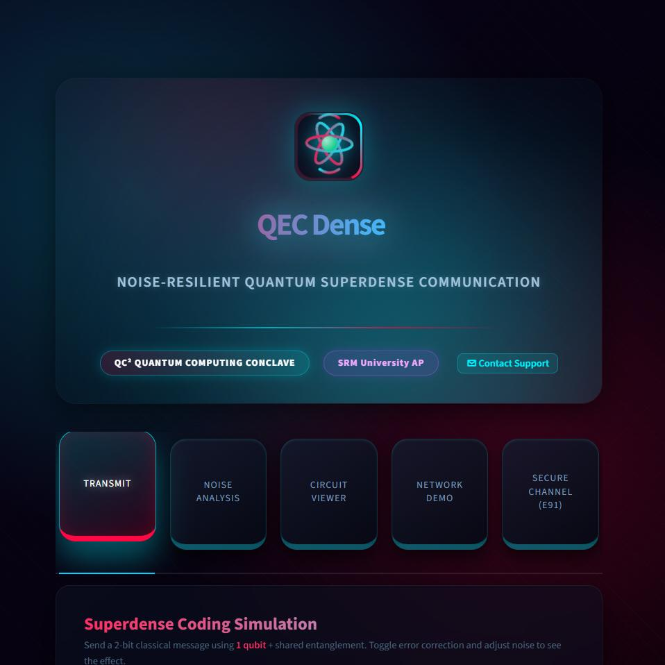
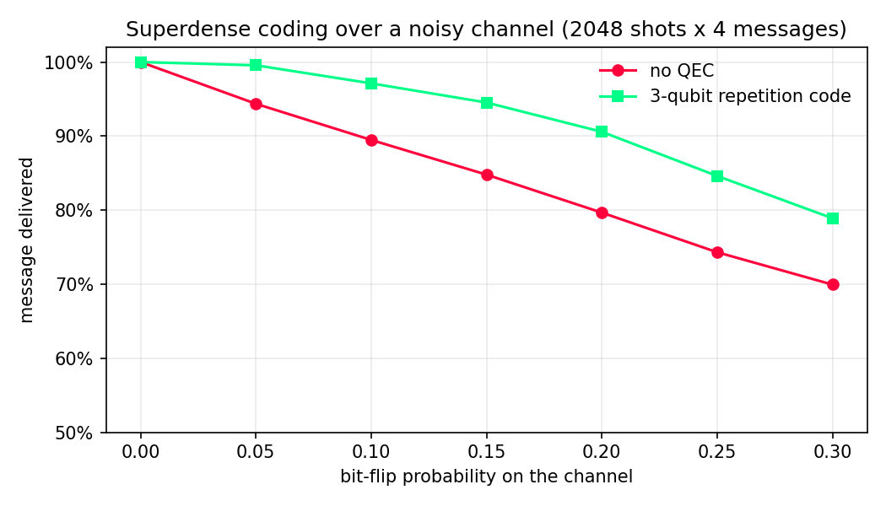

# QEC Dense: Noise-Resilient Quantum Superdense Communication

**Best Use Case of QSDC** award, QC² Quantum Computing Conclave National Hackathon, SRM University AP (2026)

Send **2 classical bits with 1 qubit** over a shared entangled pair, keep the message alive over a noisy channel with a 3-qubit repetition code, and secure it with E91 quantum key distribution. Alice and Bob run as separate programs talking over real TCP sockets.



## Team: Quantum Insiders

K. Penchala Lokesh · K. Penchala Rakesh · Ch. Joel Judson Paul · M. Paramesh Varma · K. Amareswar Rao

---

## Results

Measured with `python benchmark.py`: bit-flip noise on the channel, 2048 shots for each of the 4 messages, fixed simulator seed.

| Bit-flip probability | Delivered, no QEC | Delivered, 3-qubit code | Failures removed |
|---:|---:|---:|---:|
| 5% | 94.4% | 99.6% | 93% |
| 10% | 89.5% | 97.1% | 72% |
| 15% | 84.8% | 94.5% | 64% |
| 20% | 79.7% | 90.6% | 54% |
| 30% | 69.9% | 78.9% | 30% |



The repetition code only corrects bit-flip (X) errors. Under phase-flip or depolarizing noise it gives little or no benefit, and the app says so when you pick those noise types.

---

## Project Overview

**QEC Dense** demonstrates quantum superdense coding — a protocol that transmits **2 classical bits using just 1 qubit** over an entangled channel. We extend this with:

1. **3-Qubit Repetition Code** — protects Alice's qubit from bit-flip errors during noisy transmission
2. **E91 QKD** — generates an unconditionally secure encryption key using Bell pairs and the CHSH inequality
3. **TCP Network Layer** — Alice and Bob communicate via real TCP sockets, with QPY-serialized quantum circuits

---

## Architecture

```
┌─────────────────────────────────────────────────────────────────┐
│                     QEC Dense Architecture                       │
├─────────────────────────────────────────────────────────────────┤
│                                                                  │
│  ALICE (Sender)                         BOB (Receiver)          │
│  ┌─────────────────┐                   ┌─────────────────┐      │
│  │ 2-bit message   │                   │ Bell measurement│      │
│  │ "10"            │                   │ CNOT + H        │      │
│  └────────┬────────┘                   └────────┬────────┘      │
│           │ alice_encode()                      │ decode_result()│
│           ▼                                     ▼               │
│  ┌─────────────────┐    Shared Bell    ┌─────────────────┐      │
│  │ Superdense      │◄──── |Φ+⟩ ──────►│ Measurement     │      │
│  │ Coding Circuit  │   Entanglement    │ Outcome         │      │
│  └────────┬────────┘                   └─────────────────┘      │
│           │                                                      │
│  ┌────────▼────────┐                                            │
│  │ 3-Qubit QEC     │  ← Optional error correction layer        │
│  │ Repetition Code │    encodes logical qubit into 3 qubits     │
│  │ + Syndrome Meas │    detects & corrects single-qubit errors  │
│  └────────┬────────┘                                            │
│           │                                                      │
│  ┌────────▼────────┐    TCP Socket     ┌─────────────────┐      │
│  │ alice_client.py │──── QPY bytes ───►│  bob_server.py  │      │
│  │ (TCP client)    │    port 5000      │  (TCP server)   │      │
│  └─────────────────┘                   └─────────────────┘      │
│                                                                  │
│  ┌─────────────────────────────────────────────────────────┐    │
│  │                  E91 QKD Layer (Optional)                │    │
│  │  Bell pairs → CHSH test → shared key → XOR encryption   │    │
│  └─────────────────────────────────────────────────────────┘    │
└─────────────────────────────────────────────────────────────────┘
```

---

## Quantum Protocols Explained

### 1. Superdense Coding
Uses a pre-shared Bell pair |Φ+⟩ = (|00⟩ + |11⟩)/√2. Alice applies one of four Pauli operators to her qubit:

| Message | Gate | Effect on Bell state |
|---------|------|----------------------|
| `00` | I | |Φ+⟩ = (|00⟩+|11⟩)/√2 |
| `01` | Z | |Φ-⟩ = (|00⟩-|11⟩)/√2 |
| `10` | X | |Ψ+⟩ = (|01⟩+|10⟩)/√2 |
| `11` | XZ | |Ψ-⟩ = (|01⟩-|10⟩)/√2 |

Bob performs a Bell measurement (CNOT + H + measure) to distinguish all four states.

### 2. 3-Qubit Repetition Code
Encodes logical qubit |ψ⟩ = α|0⟩ + β|1⟩ into |ψ_L⟩ = α|000⟩ + β|111⟩.
- **Syndrome measurement**: parity checks q0⊕q1 and q1⊕q2
- **Error table**: (syn0,syn1) = (1,0)→fix q0, (1,1)→fix q1, (0,1)→fix q2
- Corrects **any single-qubit** bit-flip error

### 3. E91 QKD (Ekert 1991)
- Creates Bell pairs shared between Alice and Bob
- Each measures in randomly chosen basis (0°, 45°, 90° for Alice; 45°, 90°, 135° for Bob)
- **Matching bases** → raw key bits
- **Mismatching bases** → CHSH S-value test
- S > 2 (classical bound) confirms quantum correlations and absence of eavesdropper
- Theoretical maximum S = 2√2 ≈ 2.828

---

## Setup

```bash
# Windows (PowerShell)
cd qec-dense
python -m venv venv
venv\Scripts\activate.bat
pip install -r requirements.txt
```

---

## How to Run

### Run all tests locally (no network)
```bash
python main.py
```
Expected output: All 4 messages decode at 100% in noiseless case; plots saved to `results/`.

### Measure QEC benefit across noise levels
```bash
python benchmark.py
```

### Launch Streamlit web app
```bash
streamlit run app.py
```
Opens at http://localhost:8501 with 5 interactive tabs.

### Test network layer (two terminals)
```bash
# Terminal 1 — Bob server
python bob_server.py

# Terminal 2 — Alice client
python alice_client.py --message 10
```

### Secure mode with E91 QKD
```bash
# Terminal 1
python bob_server.py

# Terminal 2
python alice_client.py --message 10 --secure
```

---

## File Structure

```
qec-dense/
├── quantum_protocols.py   # Core quantum circuits (superdense + QEC)
├── noise_channel.py       # Qiskit Aer noise models and sweeps
├── visualization.py       # Matplotlib plots and circuit diagrams
├── alice_client.py        # TCP client (sender)
├── bob_server.py          # TCP server (receiver)
├── e91_qkd.py             # E91 QKD protocol
├── main.py                # End-to-end local demo + all plots
├── benchmark.py           # Delivery rate with vs without QEC, saves docs/delivery_vs_noise.png
├── app.py                 # Streamlit web UI (5 tabs)
├── requirements.txt
├── README.md
├── docs/                  # README images
└── results/               # Generated plots and circuit diagrams
    ├── accuracy_comparison.png
    ├── all_messages_comparison.png
    ├── histogram_10_20pct_noise.png
    └── circuit_*.png
```

---

## Evaluation Alignment

| Criterion | Implementation |
|-----------|---------------|
| Quantum Understanding | Bell pairs, superdense coding, 3-qubit repetition code, E91 |
| Technical Implementation | Qiskit 2.x API, AerSimulator, QPY serialization, TCP sockets |
| Results & Analysis | Accuracy sweeps 0–50% noise, CHSH S-value computation, comparison plots |
| Feasibility | Runs locally on any laptop; Streamlit UI for live demo |
| Presentation | Clear circuit diagrams saved as PNG for slides |
